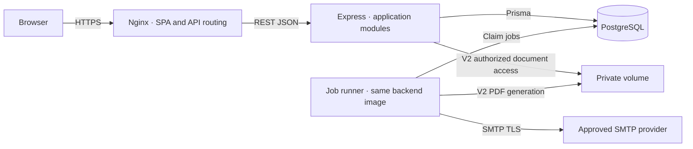

# 02 — Architecture

Use a modular monolith. React, TypeScript, Vite, Tailwind CSS, React Router and Lucide React power the browser application. Node.js, Express and TypeScript expose the API, Prisma accesses PostgreSQL, and a small mail job runner delivers SMTP messages. Docker Compose runs Nginx, the application and PostgreSQL on private networks. Nginx serves the frontend and proxies same-origin API requests over HTTPS.



The API and worker share one repository, build image and schema. The worker is a second command for the same application with independent restarts. PostgreSQL holds application records, admin sessions, limit buckets and the outbox. Runtime validators protect the HTTP boundary. Small services enforce transitions and transactions. Prisma selectors expose only documented DTO fields.

## Proposed implementation tree

```text
zahraoui-cover/
  frontend/
    src/
      assets/
      components/
      layouts/
      pages/
        public/<one folder per P page in 03-FRONTEND.md>/
        admin/<one folder per A page in 03-FRONTEND.md>/
      features/             # Shared product detail and quote wizard
      api/                  # Fetch wrapper and DTOs
      config/               # Approved public brand and privacy configuration
      router.tsx
  backend/
    src/
      modules/              # auth, catalog, intake, clients, dashboard,
                            # quotes, contracts, partners, settings,
                            # documents, notifications
      middleware/           # Sessions, permissions, CSRF, limits, errors
      config/
      app.ts
      server.ts
      worker.ts
    prisma/
      schema.prisma
      migrations/
  infrastructure/
    nginx/
    backups/
  docs/
  design-reference/
  docker-compose.yml
  .env.example
  README.md
```

A page with two modes shares a folder and uses separate route entries. All six product pages have entry folders and reuse the product template. Keep the ZIP at its current location during analysis. Add approved working references after asset review.

- One transaction covers intake, idempotency and mail job creation. Business writes and audit events commit together. Mail is asynchronous and the API returns after commit.
- The private V2 document volume sits outside the web root. Restore it with its matching database snapshot.
- Use French UI errors keyed by stable API codes. Store timestamps in UTC and display and filter dates in Africa/Casablanca.
- Version migrations and lockfiles. Isolate staging and production credentials, storage, SMTP destinations and backups.
