# 05 — PostgreSQL data model

This logical schema is implemented by the [Prisma model](../backend/prisma/schema.prisma) and the [foundation migration](../backend/prisma/migrations/20261127000000_foundation/migration.sql). Business modules and their domain validations will be added in later phases. Columns are required unless marked nullable. FK deletion defaults to RESTRICT. UK denotes a unique constraint with PostgreSQL's default distinct NULL behavior. UUID PKs use generated random UUIDs. All mutable records use positive versions, advanced with updated_at on successful writes. Store dates without a time and timestamps in UTC. Named CHECK constraints and expression/partial indexes live in the SQL migration. Primary and unique keys create their own indexes.

## Status enums and fixed values

| PostgreSQL type | Values |
| --- | --- |
| staff_role | ADVISOR, ADMIN |
| client_profile, audience (separate types) | INDIVIDUAL, BUSINESS |
| product_slug | automobile, habitation, sante, voyage, professionnelle, responsabilite-civile |
| contact_method | PHONE, EMAIL |
| quote_situation | NEW_POLICY, RENEWAL, SWITCH_PROVIDER |
| request_status | NEW, IN_REVIEW, QUOTE_SENT, ACCEPTED, DECLINED, CLOSED |
| assistance_status | NEW, IN_PROGRESS, RESOLVED |
| assistance_priority | NORMAL, URGENT |
| message_status | UNREAD, READ, PROCESSED |
| intake_action | QUOTE_REQUEST, ASSISTANCE, CONTACT |
| quote_status | DRAFT, ISSUED, SENT, ACCEPTED, DECLINED, EXPIRED, CANCELLED |
| contract_status | DRAFT, ACTIVE, CANCELLED, EXPIRED |
| document_kind | QUOTE_PDF, CONTRACT_PDF |
| document_status | QUEUED, READY, FAILED |
| job_kind | REQUEST_ALERT, REQUEST_ACK, ASSISTANCE_ALERT, CONTACT_ALERT, CONTACT_ACK, RESET_EMAIL; B8 uses GENERATE_PDF and QUOTE_DELIVERY; B9 uses RENEWAL_ALERT |
| job_status | PENDING, RUNNING, SUCCEEDED, FAILED |

Localize UI labels in French. Keep insurer offer lifecycle distinct from intake status. Immutable policy and quote snapshots are allowlisted, with customer display name and approved business terms only as needed to reproduce the document. Amounts stay numeric in PostgreSQL and decimal strings in JSON.

## Tables

### staff_users · MVP

| Column | PostgreSQL type and modifiers |
| --- | --- |
| id | uuid PK |
| created_at | timestamptz default now() |
| updated_at | timestamptz default now() |
| version | integer default 1 |
| email | varchar(254) UK |
| display_name | varchar(120) |
| role | staff_role |
| password_hash | text nullable until setup |
| is_active | boolean default true |

**Rules.** Canonical lowercase email. Login requires active account and a present password hash.

**Additional indexes.** (is_active, display_name, id).

### admin_sessions · MVP

| Column | PostgreSQL type and modifiers |
| --- | --- |
| id | uuid PK |
| created_at | timestamptz default now() |
| staff_id | uuid FK staff_users.id CASCADE |
| token_hash | bytea UK |
| last_seen_at | timestamptz |
| expires_at | timestamptz |
| revoked_at | timestamptz nullable |

**Rules.** Token hash exactly 32 bytes. Expiry represents the absolute deadline.

**Additional indexes.** (staff_id, revoked_at), (expires_at).

### password_reset_tokens · MVP

| Column | PostgreSQL type and modifiers |
| --- | --- |
| id | uuid PK |
| created_at | timestamptz default now() |
| staff_id | uuid FK staff_users.id CASCADE |
| token_hash | bytea UK |
| expires_at | timestamptz |
| used_at | timestamptz nullable |
| invalidated_at | timestamptz nullable |

**Rules.** Token hash exactly 32 bytes. Lock the user row when replacing or consuming reset tokens.

**Additional indexes.** (staff_id, expires_at), (expires_at).

### insurance_products · MVP

| Column | PostgreSQL type and modifiers |
| --- | --- |
| id | uuid PK |
| created_at | timestamptz default now() |
| updated_at | timestamptz default now() |
| version | integer default 1 |
| slug | product_slug UK |
| title | varchar(120) |
| summary | varchar(300) |
| audiences | audience[] |
| image_key | text nullable |
| potential_coverages | jsonb |
| eligibility_text | text |
| document_hints | jsonb |
| faqs | jsonb |
| related_slugs | product_slug[] |
| is_active | boolean default true |
| is_published | boolean default false |
| display_order | smallint default 0 |

**Rules.** Published rows must be active. [Migration 20261127010000](../backend/prisma/migrations/20261127010000_catalog_quote_intake/migration.sql) adds the active column and publication check. Audience count 1–2 with distinct values. JSON fields are arrays with shapes in API. Related slugs are validated as unique existing published products when edited and filtered for visibility on read. Display order 0–999.

**Additional indexes.** (is_published, display_order, id).

### clients · MVP

| Column | PostgreSQL type and modifiers |
| --- | --- |
| id | uuid PK |
| created_at | timestamptz default now() |
| updated_at | timestamptz default now() |
| version | integer default 1 |
| profile | client_profile |
| display_name | varchar(120) |
| phone | varchar(16) |
| email | varchar(254) nullable |
| city | varchar(100) nullable |
| notes | varchar(1000) nullable |
| archived_at | timestamptz nullable |
| intake_provisional | boolean default false |

**Rules.** Phone/email can repeat. A committed public quote request creates and links a provisional client. Staff can relink the request to an eligible client while preserving the submitted snapshot. Existing rows may still have no link. Enforce active relation rules under lock when linking, changing status or archiving.

**Additional indexes.** (archived_at, created_at, id), (phone), (email) and expression indexes on lower(display_name) and lower(city) for prefix search.

### quote_requests · MVP

| Column | PostgreSQL type and modifiers |
| --- | --- |
| id | uuid PK |
| created_at | timestamptz default now() |
| updated_at | timestamptz default now() |
| version | integer default 1 |
| notice_version | varchar(32) |
| acknowledged_at | timestamptz |
| reference | varchar(32) UK |
| product_id | uuid FK insurance_products.id |
| client_id | uuid nullable FK clients.id SET NULL |
| assigned_to | uuid nullable FK staff_users.id SET NULL |
| profile | client_profile |
| first_name | varchar(120) |
| last_name | varchar(120) |
| phone | varchar(16) |
| email | varchar(254) |
| city | varchar(100) |
| preferred_contact | contact_method default PHONE |
| desired_start_on | date nullable |
| situation | quote_situation default NEW_POLICY |
| needs | varchar(1000) |
| status | request_status default NEW |
| closed_at | timestamptz nullable |

**Rules.** Maintain immutable submission contact snapshot. Set closed_at for ACCEPTED, DECLINED or CLOSED and clear only on an approved reopening.

**Additional indexes.** (created_at, id), (status, created_at, id), (product_id, created_at), (client_id, created_at), (assigned_to, created_at), (phone), lower(last_name), lower(first_name), (closed_at).

### request_notes · MVP

| Column | PostgreSQL type and modifiers |
| --- | --- |
| id | uuid PK |
| created_at | timestamptz default now() |
| request_id | uuid nullable FK quote_requests.id CASCADE |
| case_id | uuid nullable FK assistance_cases.id CASCADE |
| author_id | uuid nullable FK staff_users.id SET NULL |
| body | varchar(1000) |

**Rules.** Exactly one parent is required. Append-only through the normal application. Visibility is limited to staff.

**Additional indexes.** (request_id, created_at, id), (case_id, created_at, id), (author_id).

### assistance_cases · MVP

| Column | PostgreSQL type and modifiers |
| --- | --- |
| id | uuid PK |
| created_at | timestamptz default now() |
| updated_at | timestamptz default now() |
| version | integer default 1 |
| notice_version | varchar(32) |
| acknowledged_at | timestamptz |
| reference | varchar(32) UK |
| product_id | uuid FK insurance_products.id |
| assigned_to | uuid nullable FK staff_users.id SET NULL |
| client_id | uuid nullable FK clients.id RESTRICT |
| contract_id | uuid nullable FK contracts.id RESTRICT |
| full_name | varchar(120) |
| phone | varchar(16) |
| contract_reference | varchar(64) nullable |
| description | varchar(1000) |
| status | assistance_status default NEW |
| priority | assistance_priority default NORMAL |
| closed_at | timestamptz nullable |

**Rules.** Submitted contract reference remains unverified text. Staff can link a verified client and independently select a matching existing contract. A linked contract requires a client. Set closed_at on RESOLVED.

**Additional indexes.** (status, created_at, id), (priority, created_at, id), (product_id), (closed_at), (client_id, created_at), (assigned_to), (contract_id).

### contact_messages · MVP

| Column | PostgreSQL type and modifiers |
| --- | --- |
| id | uuid PK |
| created_at | timestamptz default now() |
| updated_at | timestamptz default now() |
| version | integer default 1 |
| notice_version | varchar(32) |
| acknowledged_at | timestamptz |
| reference | varchar(32) UK |
| full_name | varchar(120) |
| phone | varchar(16) |
| email | varchar(254) |
| subject | varchar(120) |
| message | varchar(1000) |
| status | message_status default UNREAD |
| processed_at | timestamptz nullable |
| archived_at | timestamptz nullable |

**Rules.** Set processed_at on PROCESSED. Only a processed message can be archived.

**Additional indexes.** (status, created_at, id), (processed_at), (archived_at, created_at, id).

### submission_keys · MVP

| Column | PostgreSQL type and modifiers |
| --- | --- |
| action | intake_action PK part |
| key | uuid PK part |
| body_fingerprint | bytea |
| request_id | uuid nullable FK quote_requests.id CASCADE |
| case_id | uuid nullable FK assistance_cases.id CASCADE |
| message_id | uuid nullable FK contact_messages.id CASCADE |
| expires_at | timestamptz |

**Rules.** Primary key (action, key). Exactly one target, matching action. Response reconstructed from target reference and created_at.

**Additional indexes.** (expires_at), (request_id), (case_id), (message_id).

### rate_limits · MVP

| Column | PostgreSQL type and modifiers |
| --- | --- |
| scope | varchar(32) PK part |
| key_hash | bytea PK part |
| window_start | timestamptz PK part |
| hits | integer |
| expires_at | timestamptz |

**Rules.** Primary key (scope, key_hash, window_start). Positive hits and atomic increment. Hash keys with a dedicated server secret.

**Additional indexes.** (expires_at).

### audit_events · MVP

| Column | PostgreSQL type and modifiers |
| --- | --- |
| id | uuid PK |
| created_at | timestamptz default now() |
| actor_id | uuid nullable FK staff_users.id SET NULL |
| action | varchar(64) |
| target_type | varchar(32) nullable |
| target_id | uuid nullable |
| request_id | uuid nullable |
| metadata | jsonb default empty object |

**Rules.** Target is a generic audit pointer, not a foreign key. Both target fields occur together. Metadata limited to action outcome, changed field names, permitted old/new status and related technical identifiers. request_id is the HTTP correlation ID.

**Additional indexes.** (created_at), (actor_id, created_at), (target_type, target_id, created_at).

### partners · V2

| Column | PostgreSQL type and modifiers |
| --- | --- |
| id | uuid PK |
| created_at | timestamptz default now() |
| updated_at | timestamptz default now() |
| version | integer default 1 |
| name | varchar(120) |
| website | varchar(300) nullable |
| logo_key | text nullable |
| is_active | boolean default true |

**Rules.** Unique index on lower(name), HTTPS website and approved logo key. Deactivation preserves history.

**Additional indexes.** Unique lower(name); (is_active, name, id).

### quotes · B8

| Column | PostgreSQL type and modifiers |
| --- | --- |
| id | uuid PK |
| created_at | timestamptz default now() |
| updated_at | timestamptz default now() |
| version | integer default 1 |
| reference | varchar(32) UK |
| client_id | uuid FK clients.id |
| request_id | uuid nullable FK quote_requests.id SET NULL |
| product_id | uuid FK insurance_products.id |
| partner_id | uuid FK partners.id |
| created_by | uuid nullable FK staff_users.id SET NULL |
| revision | integer default 1 |
| previous_id | uuid nullable UK FK quotes.id RESTRICT |
| annual_premium_mad | numeric(12,2) |
| fees_mad, taxes_mad | numeric(12,2) default 0 |
| total_mad | numeric(12,2) nullable on legacy rows |
| currency | char(3) default MAD |
| coverage | varchar(3000) nullable |
| coverage_limits, deductibles, customer_notes, internal_notes | varchar(2000) nullable |
| conditions | varchar(2000) nullable |
| status | quote_status default DRAFT |
| valid_until | date nullable |
| sent_at | timestamptz nullable |
| decided_by | uuid nullable FK staff_users.id SET NULL |
| decision_method | varchar(16) nullable |
| decision_evidence | varchar(1000) nullable |
| issued_at | timestamptz nullable |
| decided_at | timestamptz nullable |
| issued_snapshot | jsonb nullable |

**Rules.** Positive finite premium, nonnegative fees and taxes, and fixed-point total equal to their sum in MAD. The optional request matches the client and product. Issuance freezes the offer snapshot. A revision has a separate ID and refers to its predecessor. SENT requires a transport acceptance timestamp. Legacy records retain their values.

**Additional indexes.** (status, created_at, id), (client_id, created_at), (request_id), (product_id), (partner_id), (created_by).

### contracts · B9

| Column | PostgreSQL type and modifiers |
| --- | --- |
| id | uuid PK |
| created_at | timestamptz default now() |
| updated_at | timestamptz default now() |
| version | integer default 1 |
| reference | varchar(32) UK |
| client_id | uuid FK clients.id |
| quote_id | uuid nullable UK FK quotes.id SET NULL |
| product_id | uuid FK insurance_products.id |
| partner_id | uuid FK partners.id |
| created_by | uuid nullable FK staff_users.id SET NULL |
| policy_number | varchar(64) nullable in draft |
| previous_id | uuid nullable FK contracts.id RESTRICT |
| source_quote_snapshot | jsonb nullable |
| premium_mad | numeric(12,2) nullable until recorded |
| currency | char(3) default MAD |
| coverage | varchar(3000) nullable |
| internal_notes | varchar(2000) nullable |
| confirmation_reference | varchar(160) nullable |
| confirmation_on | date nullable |
| confirmed_by | uuid nullable FK staff_users.id SET NULL |
| cancelled_at | timestamptz nullable |
| cancellation_reason | varchar(1000) nullable |
| renewal_reminders | boolean default true |
| effective_on | date |
| expires_on | date |
| status | contract_status default DRAFT |
| activated_at | timestamptz nullable |
| activation_snapshot | jsonb nullable |

**Rules.** Unique carrier/policy number when present and one contract per accepted quote. The end date is exclusive and follows the effective date. The source snapshot preserves the accepted proposal. Activation records insurer confirmation and freezes the confirmed terms. A partial unique index permits a single live or historically confirmed successor per predecessor.

**Additional indexes.** Unique (partner_id, policy_number); (status, expires_on, id), (client_id, expires_on), (product_id), (created_by), (previous_id), (confirmed_by), (partner_id).

### documents · B8 quote PDF and B9 insurer-provided PDF

| Column | PostgreSQL type and modifiers |
| --- | --- |
| id | uuid PK |
| created_at | timestamptz default now() |
| quote_id | uuid nullable FK quotes.id |
| contract_id | uuid nullable FK contracts.id |
| kind | document_kind |
| revision | integer |
| quote_version | integer nullable (quote version after issuance) |
| mime_type | varchar(32) nullable, application/pdf for B8/B9 |
| status | document_status default QUEUED |
| storage_key | text nullable UK |
| sha256 | bytea nullable |
| size_bytes | bigint nullable |
| ready_at | timestamptz nullable |

**Rules.** Exactly one parent matches kind. Revision > 0. READY requires safe storage key, 32-byte digest, positive size and ready_at. Distinct revision per parent. Private PDF MIME is fixed.

**Additional indexes.** Unique partial (quote_id, revision) where quote_id is present and (contract_id, revision) where contract_id is present; (status, created_at).

### agency_settings · V2

| Column | PostgreSQL type and modifiers |
| --- | --- |
| id | smallint PK default 1 |
| updated_at | timestamptz |
| version | integer default 1 |
| agency_name | varchar(120) |
| office_phone | varchar(16) |
| assistance_phone | varchar(16) |
| email | varchar(254) nullable |
| address | varchar(300) nullable |
| hours | varchar(300) nullable |

**Rules.** Single row id 1, approved identity and primary/assistance numbers fixed by configuration and seeded settings.

**Additional indexes.** PK only.

### outbox_jobs · MVP with V2 extensions

| Column | PostgreSQL type and modifiers |
| --- | --- |
| id | uuid PK |
| created_at | timestamptz default now() |
| kind | job_kind |
| dedupe_key | varchar(128) UK |
| request_id | uuid nullable FK quote_requests.id CASCADE |
| case_id | uuid nullable FK assistance_cases.id CASCADE |
| message_id | uuid nullable FK contact_messages.id CASCADE |
| reset_id | uuid nullable FK password_reset_tokens.id CASCADE |
| document_id | uuid nullable FK documents.id CASCADE V2 |
| contract_id | uuid nullable FK contracts.id CASCADE |
| reminder_expires_on | date nullable, term used to schedule reminder |
| reminder_days | smallint nullable, offset in calendar days |
| encrypted_secret | bytea nullable |
| state | job_status default PENDING |
| attempt_count | smallint default 0 |
| next_attempt_at | timestamptz |
| lease_until | timestamptz nullable |
| lease_token | uuid nullable |
| finished_at | timestamptz nullable |
| last_error_code | varchar(64) nullable |

**Rules.** Exactly one target for each job kind. RESET_EMAIL has encrypted secret while runnable. Worker uses lease token to finalize. Clear secret on terminal status. Add V2 columns and kinds with related tables.

**Additional indexes.** (state, next_attempt_at, id), (state, lease_until), (finished_at), individual target FK indexes.

Search initially uses normalized phone or reference and escaped prefix matches on names or cities, with matching expression indexes (use text_pattern_ops for prefix B-tree indexes under non-C collation). Keep stable pagination and measure query plans before adding other indexes. Audit updates and domain writes commit together. Enforce last-read version checks and cross-record rules in transactions with consistent lock order.

## Entity relationship diagram

The diagram includes all 18 proposed tables. Optional and composite constraints are specified above. [Mermaid ER notation](https://mermaid.js.org/syntax/entityRelationshipDiagram.html)

```mermaid
erDiagram
    staff_users ||..o{ admin_sessions : "staff_id"
    staff_users ||..o{ password_reset_tokens : "staff_id"
    insurance_products ||..o{ quote_requests : "product_id"
    clients |o..o{ quote_requests : "client_id"
    staff_users |o..o{ quote_requests : "assigned_to"
    quote_requests |o..o{ request_notes : "request_id"
    assistance_cases |o..o{ request_notes : "case_id"
    clients |o..o{ assistance_cases : "client_id"
    staff_users |o..o{ assistance_cases : "assigned_to"
    contracts |o..o{ assistance_cases : "contract_id"
    staff_users |o..o{ request_notes : "author_id"
    insurance_products ||..o{ assistance_cases : "product_id"
    quote_requests |o..o{ submission_keys : "request_id"
    assistance_cases |o..o{ submission_keys : "case_id"
    contact_messages |o..o{ submission_keys : "message_id"
    staff_users |o..o{ audit_events : "actor_id"
    clients ||..o{ quotes : "client_id"
    quote_requests |o..o{ quotes : "request_id"
    insurance_products ||..o{ quotes : "product_id"
    partners ||..o{ quotes : "partner_id"
    staff_users |o..o{ quotes : "created_by"
    clients ||..o{ contracts : "client_id"
    contracts |o..o{ contracts : "previous_id"
    quotes |o..o| contracts : "quote_id"
    insurance_products ||..o{ contracts : "product_id"
    partners ||..o{ contracts : "partner_id"
    staff_users |o..o{ contracts : "created_by"
    quotes |o..o{ documents : "quote_id"
    contracts |o..o{ documents : "contract_id"
    quote_requests |o..o{ outbox_jobs : "request_id"
    assistance_cases |o..o{ outbox_jobs : "case_id"
    contact_messages |o..o{ outbox_jobs : "message_id"
    password_reset_tokens |o..o{ outbox_jobs : "reset_id"
    documents |o..o{ outbox_jobs : "document_id"
    contracts |o..o{ outbox_jobs : "contract_id"
    staff_users {
        uuid id PK
        timestamptz created_at
        timestamptz updated_at
        integer version
        varchar_254 email UK
        varchar_120 display_name
        staff_role role
        text password_hash
        boolean is_active
    }
    admin_sessions {
        uuid id PK
        timestamptz created_at
        uuid staff_id FK
        bytea token_hash UK
        timestamptz last_seen_at
        timestamptz expires_at
        timestamptz revoked_at
    }
    password_reset_tokens {
        uuid id PK
        timestamptz created_at
        uuid staff_id FK
        bytea token_hash UK
        timestamptz expires_at
        timestamptz used_at
        timestamptz invalidated_at
    }
    insurance_products {
        uuid id PK
        timestamptz created_at
        timestamptz updated_at
        integer version
        product_slug slug UK
        varchar_120 title
        varchar_300 summary
        audience_array audiences
        text image_key
        jsonb potential_coverages
        text eligibility_text
        jsonb document_hints
        jsonb faqs
        product_slug_array related_slugs
        boolean is_active
        boolean is_published
        smallint display_order
    }
    clients {
        uuid id PK
        timestamptz created_at
        timestamptz updated_at
        integer version
        client_profile profile
        varchar_120 display_name
        varchar_16 phone
        varchar_254 email
        varchar_100 city
        varchar_1000 notes
        timestamptz archived_at
        boolean intake_provisional
    }
    quote_requests {
        uuid id PK
        timestamptz created_at
        timestamptz updated_at
        integer version
        varchar_32 notice_version
        timestamptz acknowledged_at
        varchar_32 reference UK
        uuid product_id FK
        uuid client_id FK
        uuid assigned_to FK
        client_profile profile
        varchar_120 first_name
        varchar_120 last_name
        varchar_16 phone
        varchar_254 email
        varchar_100 city
        contact_method preferred_contact
        date desired_start_on
        quote_situation situation
        varchar_1000 needs
        request_status status
        timestamptz closed_at
    }
    request_notes {
        uuid id PK
        timestamptz created_at
        uuid request_id FK
        uuid case_id FK
        uuid author_id FK
        varchar_1000 body
    }
    assistance_cases {
        uuid id PK
        timestamptz created_at
        timestamptz updated_at
        integer version
        varchar_32 notice_version
        timestamptz acknowledged_at
        varchar_32 reference UK
        uuid product_id FK
        uuid assigned_to FK
        uuid client_id FK
        uuid contract_id FK
        varchar_120 full_name
        varchar_16 phone
        varchar_64 contract_reference
        varchar_1000 description
        assistance_status status
        assistance_priority priority
        timestamptz closed_at
    }
    contact_messages {
        uuid id PK
        timestamptz created_at
        timestamptz updated_at
        integer version
        varchar_32 notice_version
        timestamptz acknowledged_at
        varchar_32 reference UK
        varchar_120 full_name
        varchar_16 phone
        varchar_254 email
        varchar_120 subject
        varchar_1000 message
        message_status status
        timestamptz processed_at
        timestamptz archived_at
    }
    submission_keys {
        intake_action action PK
        uuid key PK
        bytea body_fingerprint
        uuid request_id FK
        uuid case_id FK
        uuid message_id FK
        timestamptz expires_at
    }
    rate_limits {
        varchar_32 scope PK
        bytea key_hash PK
        timestamptz window_start PK
        integer hits
        timestamptz expires_at
    }
    audit_events {
        uuid id PK
        timestamptz created_at
        uuid actor_id FK
        varchar_64 action
        varchar_32 target_type
        uuid target_id
        uuid request_id
        jsonb metadata
    }
    partners {
        uuid id PK
        timestamptz created_at
        timestamptz updated_at
        integer version
        varchar_120 name
        varchar_300 website
        text logo_key
        boolean is_active
    }
    quotes {
        uuid id PK
        timestamptz created_at
        timestamptz updated_at
        integer version
        varchar_32 reference UK
        uuid client_id FK
        uuid request_id FK
        uuid product_id FK
        uuid partner_id FK
        uuid created_by FK
        integer revision
        uuid previous_id FK, UK
        numeric_12_2 annual_premium_mad
        numeric_12_2 fees_mad
        numeric_12_2 taxes_mad
        numeric_12_2 total_mad
        char_3 currency
        varchar_3000 coverage
        varchar_2000 coverage_limits
        varchar_2000 deductibles
        varchar_2000 customer_notes
        varchar_2000 internal_notes
        varchar_2000 conditions
        quote_status status
        timestamptz issued_at
        date valid_until
        timestamptz sent_at
        timestamptz decided_at
        uuid decided_by FK
        varchar_16 decision_method
        varchar_1000 decision_evidence
        jsonb issued_snapshot
    }
    contracts {
        uuid id PK
        timestamptz created_at
        timestamptz updated_at
        integer version
        varchar_32 reference UK
        uuid client_id FK
        uuid quote_id FK, UK
        uuid product_id FK
        uuid partner_id FK
        uuid created_by FK
        varchar_64 policy_number
        uuid previous_id FK
        jsonb source_quote_snapshot
        numeric_12_2 premium_mad
        char_3 currency
        varchar_3000 coverage
        varchar_2000 internal_notes
        varchar_160 confirmation_reference
        date confirmation_on
        uuid confirmed_by FK
        timestamptz cancelled_at
        varchar_1000 cancellation_reason
        boolean renewal_reminders
        date effective_on
        date expires_on
        contract_status status
        timestamptz activated_at
        jsonb activation_snapshot
    }
    documents {
        uuid id PK
        timestamptz created_at
        uuid quote_id FK
        uuid contract_id FK
        document_kind kind
        integer revision
        integer quote_version
        varchar_32 mime_type
        document_status status
        text storage_key UK
        bytea sha256
        bigint size_bytes
        timestamptz ready_at
    }
    agency_settings {
        smallint id PK
        timestamptz updated_at
        integer version
        varchar_120 agency_name
        varchar_16 office_phone
        varchar_16 assistance_phone
        varchar_254 email
        varchar_300 address
        varchar_300 hours
    }
    outbox_jobs {
        uuid id PK
        timestamptz created_at
        job_kind kind
        varchar_128 dedupe_key UK
        uuid request_id FK
        uuid case_id FK
        uuid message_id FK
        uuid reset_id FK
        uuid document_id FK
        uuid contract_id FK
        date reminder_expires_on
        smallint reminder_days
        bytea encrypted_secret
        job_status state
        smallint attempt_count
        timestamptz next_attempt_at
        timestamptz lease_until
        uuid lease_token
        timestamptz finished_at
        varchar_64 last_error_code
    }
```

## Retention and handling

These are engineering proposals for business and privacy review. Confirm production periods, lawful basis, mandatory record rules and any necessary holds before storing live data.

| Data | Proposed handling |
| --- | --- |
| Rate keys / submission keys | Purge expired rate buckets daily and idempotency rows after 24 hours. |
| Sessions / reset links | Expire on the schedules in [Authentication](07-AUTHENTICATION.md). Purge expired or revoked sessions and used/invalidated reset rows within seven days. Clear SMTP secret immediately on terminal job status or token expiry. |
| Unconverted quote intake | Review 12 months after closure. Purge personal fields through deletion of the intake record and notes unless an approved hold applies. Quoted/converted files follow the approved business schedule. |
| Contact / assistance | Review for deletion six months after processing or resolution. Review stale open cases on a recurring basis. |
| Clients / V2 quotes / contracts / documents | Restrict archived records. Apply an approved business and legal retention schedule and hold process. Purge files, snapshots and related database rows in dependency order using a retryable maintenance job. Maintain a redacted completion record. |
| Outbox / audit / infrastructure | Proposed 30 days after terminal outbox status, 12 months for redacted audit history, 30 days rotating encrypted backups. Apply approved disposal rules and replay post-snapshot deletions before restored data serves traffic. |

Track the source of each approved policy and separate discovery of candidates from scheduled deletion. Limit maintenance access, record decisions without copying payloads and regularize review of active holds.
