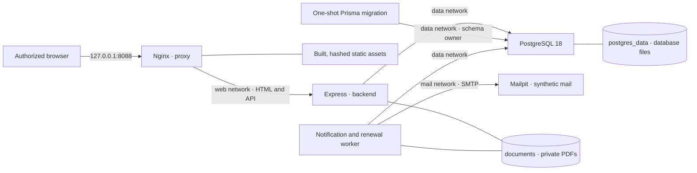

# 39 — Docker infrastructure guide

| Service | Responsibility |
| --- | --- |
| `proxy` | Non-root Nginx serves the immutable hashed assets and proxies HTML, SEO and API routes. It forwards 404s, CSP and private cache controls from the app. It blocks database readiness routes at the edge. |
| `backend` | The Express process serves the application and JSON API. It still decides whether a public product exists, whether a user can access an admin record and whether a document can be downloaded. |
| `worker` | Runs the compiled worker from the shared backend image, writes PDFs and processes reminders and notifications. Its health probe checks database, private storage and Mailpit. Delivery and job history are the evidence that queues are processing. |
| `migrate` | Uses the same compiled source and dependency set as the backend, with the Prisma CLI and migration history added. The serving images have the generated Prisma client and omit the CLI and optional build packages. It exits after `migrate deploy`. A successful migration is required before the API and worker start. |
| `postgres` | PostgreSQL 18 persists records. The one-shot initialization creates a non-superuser app role with data permissions and a separate schema owner used for migrations and backups. |
| `mailpit` | A non-root mail sink on its own internal network. Its inbox is temporary and capped. Neither its SMTP nor its HTTP UI is published to the host. |

Only Nginx joins the non-internal `entry` network to support the loopback port. The private `web` network connects Nginx to the API, `data` connects the API and worker to PostgreSQL and the migrator, and `mail` connects the worker to Mailpit. The API has no path to Mailpit through the Compose service networks and only records jobs. The worker and Mailpit have no external mail relay.

`postgres_data` is mounted at `/var/lib/postgresql`, the PostgreSQL 18 volume path. `documents` is mounted at `/private-documents` on API and worker, owned by UID 1000 with directory mode 0700. It holds generated quote PDFs, policy PDFs and supporting documents. The Nginx image and container have no document mount. Compose `stop`, recreation and `down` without the volume flag preserve both named volumes. [PostgreSQL 18 image volume guidance](https://github.com/docker-library/docs/blob/master/postgres/content.md#pgdata)

| Configuration | Purpose |
| --- | --- |
| [Dockerfile](../Dockerfile) | Multi-stage build uses Node.js 24.22.3, compiles both projects from npm lockfiles, installs production dependencies separately, and produces five staging images. The API and worker share one image. PostgreSQL and Mailpit are thin layers over pinned upstream images. Base image digests are pinned. Debian and Alpine packages are refreshed during a clean build. The Node runtime images omit the build-only npm and Yarn tools. The non-root PostgreSQL image omits the unused root-to-user helper, gosu. |
| [.dockerignore](../.dockerignore) | Restricts the build context to the required source. Local dependencies, secrets, the design archive and generated private files are excluded. |
| [compose.staging.yml](../compose.staging.yml) | Defines the six services, dependency gates, limits, health checks, restart policies, volumes, networks and rotated local logging. |
| [Environment template](../.env.staging.example) | Lists the required secrets and loopback port. The generated file stays outside Git. |
| [Nginx configuration](../docker/staging/nginx.conf) | Caps uploads at 4 MiB, replaces untrusted forwarding headers, suppresses status rewriting and keeps staging noindex. Its access log avoids paths and query strings. |
| [Database initialization](../docker/staging/init-db.sh) | Grants narrowly scoped runtime data access during first database creation. |
| [Worker health](../docker/staging/worker-health.mjs) and [document check](../docker/staging/check-documents.mjs) | Validate worker dependencies and verify restored PDF lengths and SHA-256 digests using the application reader. |

Application, migrator, proxy and mail sink use read-only root filesystems and temporary writable scratch space. Services run as non-root users, drop Linux capabilities and have CPU, memory and process limits. Docker rotates their logs. The API and worker handle termination signals and have time to finish shutdown. Database writes use a separate named data volume. [Nginx unprivileged image](https://github.com/nginx/docker-nginx-unprivileged) · [Compose startup order](https://docs.docker.com/compose/how-tos/startup-order/)

The staging pins include the November security releases for Node.js and Mailpit. The proxy uses Nginx 1.30.8. Refresh the pinned digests through a reviewed image build and vulnerability scan. [Node.js security releases](https://nodejs.org/en/blog/vulnerability/november-2026-security-releases/) · [Mailpit v1.34.0 release](https://github.com/axllent/mailpit/releases/tag/v1.34.0) · [Nginx security advisories](https://nginx.org/en/security_advisories.html)

## Image security audit

Trivy 0.76.2 scanned the local Linux image archives using the verified 28 November 2026 vulnerability database. npm audit reported zero advisories for the backend, frontend and browser toolchain. Trivy found no image secrets. Sizes below are the local Docker image sizes in decimal MB, including shared layers.

| Staging image | Size | Trivy vulnerability entries |
| --- | ---: | --- |
| API and worker | 556.5 MB | 1 critical flagged, 33 high, 108 medium, 97 low, 18 unknown |
| Prisma migrator | 865.5 MB | Same shared Debian findings as API and worker |
| Nginx | 95.8 MB | 0 |
| PostgreSQL | 445.6 MB | 0 |
| Mailpit | 62.8 MB | 0 |

Package refreshes cleared the Alpine findings, including the PostgreSQL and Nginx libxml2 findings. The PostgreSQL staging image removed the unused `gosu` binary, which had carried a critical Go standard-library finding. Debian updates and removing the npm toolchain from the serving and migration images took the Node images from 44 to 33 high entries each.

Trivy's remaining critical entry on the Debian images is CVE-2023-45853, a MiniZip issue. Debian says Bookworm's `zlib1g` does not build the affected MiniZip component. The runtime package inspection confirmed that MiniZip packages are absent. The scanner entry is retained in the record. The other high entries cover inherited Debian packages such as util-linux, zlib and gzip. Trivy reported no fixed Bookworm versions for those high entries in this snapshot. Review their applicability and supported replacements before production. [Debian tracker for CVE-2023-45853](https://security-tracker.debian.org/tracker/CVE-2023-45853)

The image-only scan also flagged absent embedded health checks and an inherited Nginx build command that uses `cd`. Compose supplies health checks for the long-running staging services. The migration job is checked by its exit status. [Trivy 0.76.2](https://github.com/aquasecurity/trivy/releases/tag/v0.76.2)
